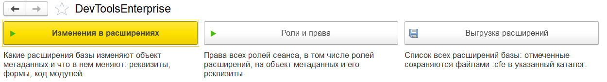
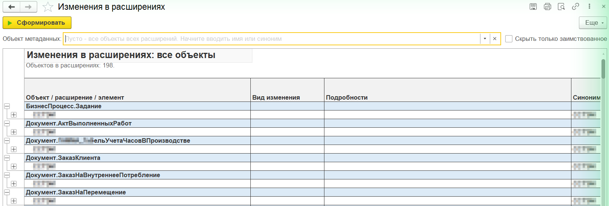
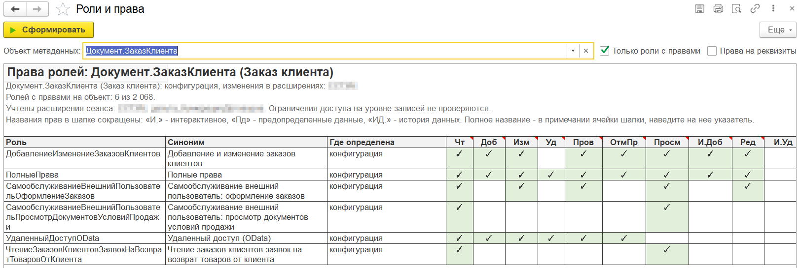
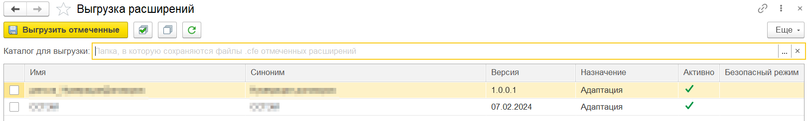

# DevToolsEnterprise

Внешний отчёт для 1С:Предприятие 8.3. Он помогает разработчику и администратору разобраться с расширениями
конфигурации информационной базы:

| Инструмент | Что делает |
|---|---|
| [Изменения в расширениях](#изменения-в-расширениях) | Какие расширения базы изменяют объект метаданных и что именно в нём меняют |
| [Расширение и вид изменения](#расширение-и-вид-изменения) | Что делают выбранные расширения: какие объекты добавляет, какие изменяет и что в них меняет, какие только заимствует |
| [Роли и права](#роли-и-права) | Права всех ролей сеанса, включая роли расширений, на объект и его реквизиты |
| [Выгрузка расширений](#выгрузка-расширений) | Список всех расширений базы; отмеченные сохраняются файлами `.cfe` в каталог |

Готовый `DevToolsEnterprise.erf` прикладывается к [релизам](../../releases).



## Как запустить

1. Откройте отчёт в режиме 1С:Предприятие: *Файл → Открыть*, файл `DevToolsEnterprise.erf`.
   Пользователь должен иметь административные права, иначе платформа не отдаёт содержимое расширений.
2. На стартовой форме нажмите кнопку нужного инструмента. Каждый инструмент открывается в отдельной вкладке.

Требуется платформа 8.3.27 или новее.

## Изменения в расширениях

Ищет выбранные объекты метаданных во всех расширениях, записанных в базу, в том числе в отключённых.
Показывает, что каждое расширение в этих объектах меняет.

1. Укажите объекты в поле «Объекты метаданных»:
   - введите часть имени или синонима и выберите объект из подсказки, например `Справочник.ДоговорыКонтрагентов`;
     несколько объектов перечисляются через запятую, подсказка подбирает объект после последней запятой;
   - или нажмите «…»: откроется список объектов всех расширений с флажками и поиском по имени и синониму.

   Пустое поле — все объекты всех расширений.
2. Нажмите «Сформировать» (Ctrl+Enter).

Результат выводится в табличный документ: объект → расширение → элементы. Строки элементов сворачиваются.
Имена можно копировать из ячеек (Ctrl+C). Для расширения выводятся синоним, версия, активность,
безопасный режим, изменение структуры данных и назначение. Вид изменения элемента:

| Вид изменения | Что значит |
|---|---|
| новый | реквизит, табличная часть, форма, команда и т. п. добавлены расширением |
| заимствован | элемент заимствован без изменений |
| заимствован, изменен | у заимствованной формы есть код в модуле или изменены элементы, реквизиты, команды, обработчики |
| код | в модуле объекта, менеджера или команды есть код; в «Подробностях» перечислены перехваты `&Перед`, `&После`, `&Вместо`, `&ИзменениеИКонтроль` |
| изменена | изменена заимствованная общая форма |

Флажок **«Не учитывать заимствованные объекты»** убирает объекты, которые расширение только заимствует (без своих
элементов, кода в модулях и изменений в формах), и заимствованные элементы без изменений.

Кнопка **«Выгрузить расширения»** (рядом с флажком и в меню «Еще») открывает «Выгрузку расширений», в которой
отмечены расширения из текущего результата отчета. Если отчет еще не сформирован, он сначала формируется.



### Как это устроено

- Состав объекта берётся из метаданных расширения: `Новый ОбъектМетаданныхКонфигурация(Расширение.ПолучитьДанные())`.
  Новый элемент или заимствованный, определяется по `ПринадлежностьОбъекта`.
- Код модулей и изменения форм читаются из двоичных данных расширения (контейнер `.cfe`). Записи контейнера
  сжаты deflate без заголовка, а встроенный язык такое сжатие не распаковывает. Поэтому записи кладутся в ZIP
  без контрольной суммы и извлекаются через `ЧтениеZipФайла`: платформа записывает файл целиком и только потом
  сообщает об ошибке контрольной суммы.
- Заимствованная форма без изменений имеет пустой модуль, а её описание совпадает с описанием базовой формы.

### Ограничения

- Распаковка опирается на недокументированное поведение `ЧтениеZipФайла`, проверено на платформе 8.3.27.
  Если данные расширения прочитать не удалось, объект не скрывается, а причина указана в «Подробностях».
- Не анализируются добавленные в заимствованные подсистемы объекты, определяемые типы и функциональные опции.
- Кодом считается любая строка модуля, кроме пустых строк, комментариев и инструкций препроцессора (`#`).

## Расширение и вид изменения

Показывает всё, что делают выбранные расширения базы.

1. Укажите расширения в поле «Расширения»: начните вводить имя или синоним и выберите из подсказки
   (несколько — через запятую) или нажмите «…» и отметьте флажками в списке расширений базы,
   в том числе отключённых. По каждому расширению выводится свой блок, блоки идут друг под другом.
2. При необходимости включите **«Не учитывать заимствованные объекты»**: объекты, которые расширение только
   заимствует, и заимствованные элементы без изменений не выводятся.
3. Нажмите «Сформировать» (Ctrl+Enter).

Под заголовком — синоним, версия, назначение, активность, безопасный режим, изменение структуры данных и число
объектов каждого вида. Объекты разделены на разделы:

| Раздел | Что в нём |
|---|---|
| Новые объекты | объекты, которые расширение добавляет |
| Изменяемые объекты | заимствованные объекты, в которых расширение добавляет элементы, пишет код в модулях или меняет формы; в «Подробностях» строки объекта — перечень изменённых элементов и модулей |
| Только заимствованные объекты | заимствованные объекты без изменений; раздел скрыт, если включён флажок |

Под строкой объекта — его элементы и модули с видом изменения и подробностями (перехваты методов, что изменено
в форме), как в отчёте [«Изменения в расширениях»](#изменения-в-расширениях). Строки объектов сворачиваются;
с флажком «Не учитывать заимствованные объекты» они раскрыты сразу.

## Роли и права

Матрица «роль × право» на выбранный объект метаданных для всех ролей сеанса, в том числе ролей расширений.
Объектов можно указать несколько — как в отчёте [«Изменения в расширениях»](#изменения-в-расширениях):
через запятую в поле «Объекты метаданных» или кнопкой «…». По каждому объекту выводится своя матрица;
если объект не найден, в его блоке написана причина, остальные выводятся.
Учитываются только расширения, применённые в текущем сеансе. Названия прав в шапке сокращены («И.» — интерактивное, «Пд» — предопределённые данные,
«ИД.» — история данных). Полное название видно в примечании ячейки шапки при наведении указателя.

- **Только роли с правами** — скрыть роли, у которых нет прав на объект.
- **Права на реквизиты** — вывести права на реквизиты и табличные части, если они урезаны
  относительно прав на объект.
- **Только роли с ограничением на уровне записей** — оставить роли, у которых право Чтение, Добавление,
  Изменение или Удаление на объект ограничено условием (RLS). Такие права в матрице отмечаются всегда,
  и без флажка: «✓У» на жёлтом фоне. Платформа сообщает только факт ограничения (`ПараметрыДоступа`),
  текст условия из встроенного языка получить нельзя.



## Выгрузка расширений

Список всех расширений базы, в том числе отключённых: имя, синоним, версия, назначение, активность,
безопасный режим.

1. Отметьте нужные расширения флажками («Отметить все» / «Снять отметки»).
2. Укажите каталог в поле «Каталог для выгрузки» или выберите его кнопкой «…». Путь запоминается.
3. Нажмите «Выгрузить отмеченные» (Ctrl+Enter).

Каждое отмеченное расширение сохраняется в каталог файлом `<Имя расширения>.cfe`. Если каталога нет,
он создаётся. Файл с тем же именем перезаписывается без вопроса. Файлы передаются с сервера через
`ПолучитьФайлыССервераАсинх`, поэтому в веб-клиенте нужно расширение работы с файлами.



## Сборка из исходников

Исходники лежат в `src/` в формате выгрузки XML (формат 2.20, платформа 8.3.27).

В Конфигураторе любой базы на платформе 8.3.27 или новее откройте `src/DevToolsEnterprise.xml`
(*Файл → Открыть*), затем выполните *Файл → Сохранить как* `.erf`. Или из командной строки:

```bat
"C:\Program Files\1cv8\8.3.27.2342\bin\1cv8.exe" DESIGNER /F "<каталог любой файловой базы>" ^
  /LoadExternalDataProcessorOrReportFromFiles "src\DevToolsEnterprise.xml" ^
  "build\DevToolsEnterprise.erf" /DisableStartupDialogs
```

Скрипт `scripts\build.bat` делает то же без своей базы: при первом запуске создаёт пустую файловую
базу `build\stub-ib` и собирает отчёт в `build\DevToolsEnterprise.erf`.

## Разработка

| Каталог / файл | Что там |
|---|---|
| `src/` | исходники отчёта |
| `scripts/build.bat` | сборка отчёта и служебной обработки открытия |
| `scripts/test.bat [база]` | собрать и открыть отчёт в тестовой базе |
| `scripts/run-1c.bat` | открыть тестовую базу (`-Base`, `-OpenReport`, `-URL`) |
| `tools/launcher/` | исходники служебной обработки: подключает собранный `.erf` и открывает его форму |
| `tools/smoke-com.ps1` | проверка серверной части отчёта через COM, без интерфейса |
| `tools/compare-cfe.ps1` | сверка выгруженных `.cfe` с расширениями базы |
| `tools/ui.ps1`, `tools/pixelate.ps1` | окна и снимки экрана клиента, подготовка скриншотов |
| `.v8-project.json.example` | образец реестра тестовых баз (сам `.v8-project.json` в git не попадает) |
| `.bsl-language-server.json`, `.mcp.json` | BSL Language Server для анализа кода |
| `openspec/`, `.claude/` | работа по спецификациям OpenSpec в Claude Code (`/opsx:*`) |

Тестовые базы описываются в `.v8-project.json` (формат реестра баз
[1c-skills](https://github.com/Nikolay-Shirokov/cc-1c-skills)): скопируйте образец и укажите файловые
базы с расширениями, на которых проверяете отчёт. Скрипты берут базу по `id` или алиасу,
без параметра — базу `default`.
